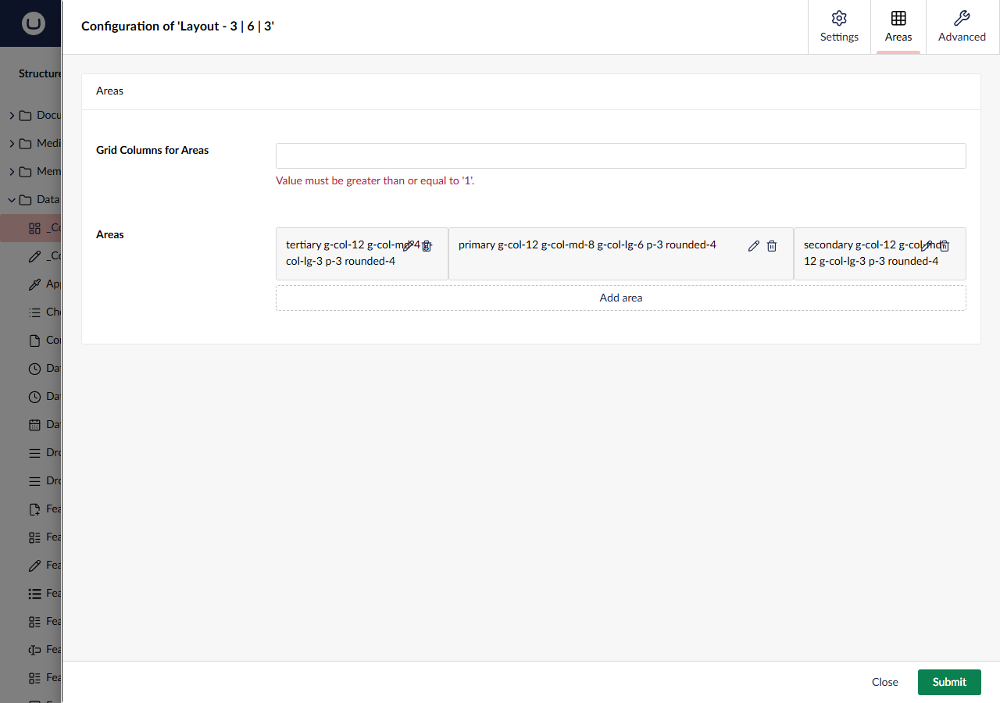
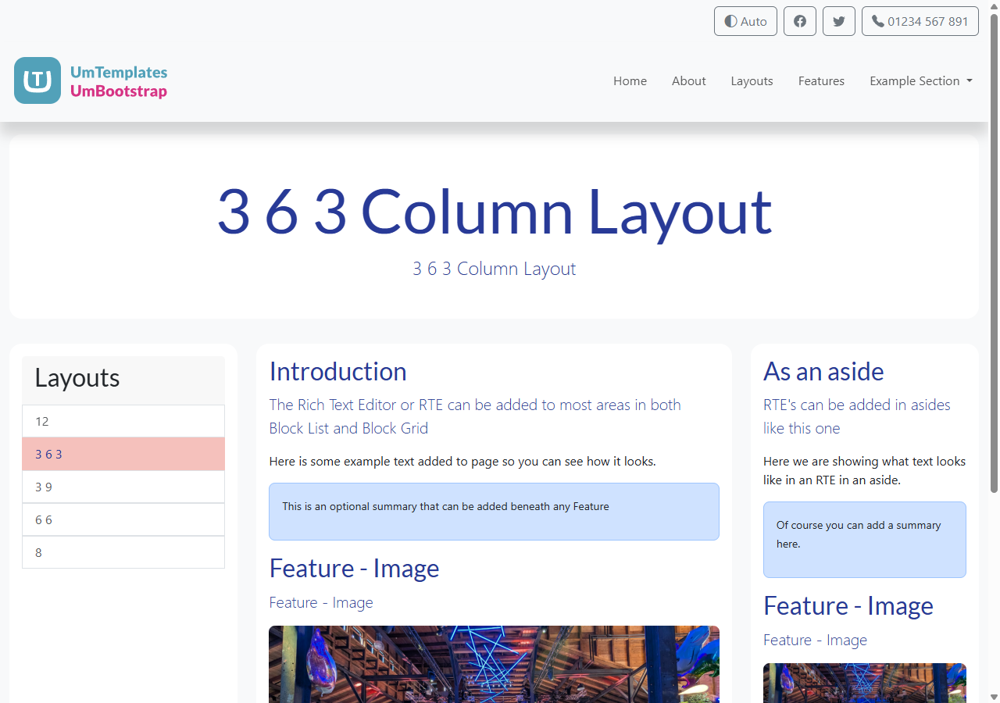
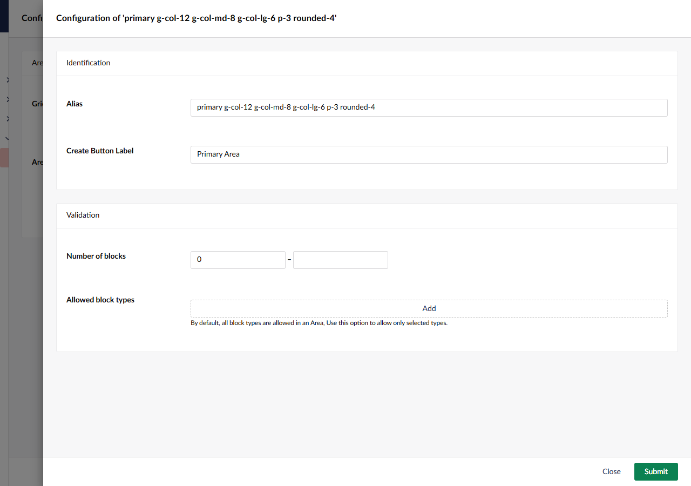
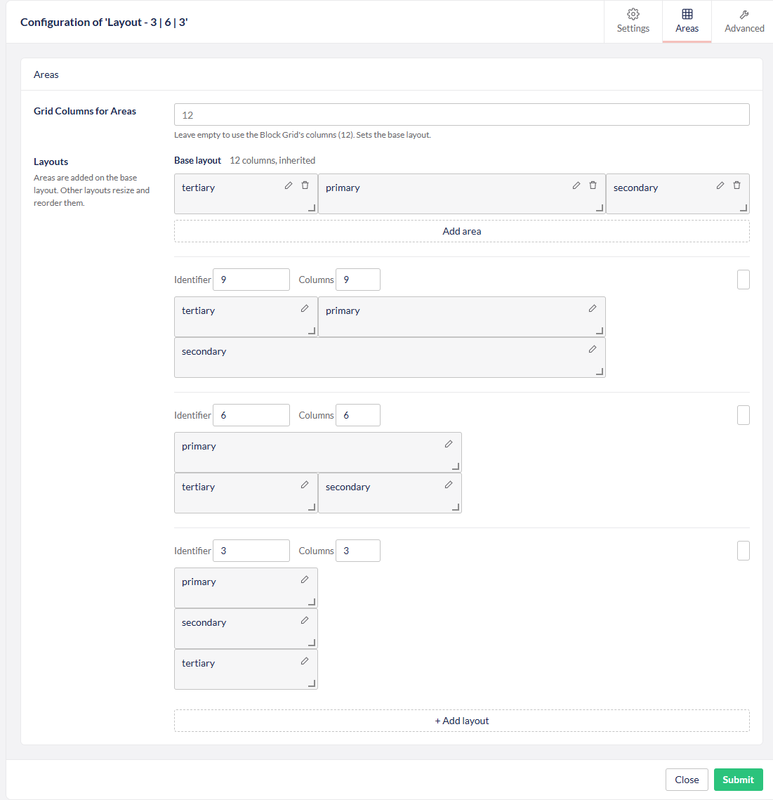

ResponsiveAreas gives Block Grid areas more than one layout.

This page shows how areas work today, where that falls short, and what we are building instead.

## How Block Grid areas work today

A Block Grid block can contain **areas**.
Areas are the slots editors put content into.

You set them up on the block type's **Areas** tab:

- **Grid Columns for Areas** sets how many columns the block has.
- Each area is a grey box with an alias.
- You drag a box's corner to set how many columns it spans.

This block has three areas: tertiary, primary and secondary.
They span 3, 6 and 3 of 12 columns.

On the front end, that gives a three-column layout.

## The problem

Each block has **one** layout.

3 | 6 | 3 works on a wide screen.
On a tablet or a phone, three columns are too narrow.
The areas need to change their spans, and sometimes their order.

Core has no way to say that.

### The workaround

The common workaround puts CSS framework classes into the area's **alias**.

The site's views print the alias as a class.
Bootstrap does the rest.

It works.
At tablet width, this block becomes 4 | 8, and the aside drops below.

But it has costs:

- **The alias becomes styling.** An alias should identify an area. Here it carries spans, padding and corner radius.
- **It is tied to one framework.** Change from Bootstrap and every alias breaks.
- **Editors cannot see it.** The Areas tab shows one layout. The tablet and phone layouts exist only as class names.
- **It is easy to break.** One typo in an alias changes the layout silently.

## What we are building

ResponsiveAreas replaces the block type's **Areas** tab.

The new tab keeps everything editors know from core, and adds **layouts**.

:::note
This is a mockup, not the finished tab.
The real tab is built from core's own Areas tab, so it looks and behaves like Umbraco.
You can [try the interactive mockup](/mockups/responsive-areas-tab-mockup.html).
:::

- **The base layout** is the one you know. Areas are added and deleted here.
- **Each extra layout** has an identifier and a column count.
- **In each layout, the same areas** can be resized and reordered.
- **Each layout is drawn to scale**, so a 6-column layout is half the width of a 12-column one.

Aliases go back to being names.

## How the front end uses it

ResponsiveAreas does not decide when a layout applies.
**Your site's CSS does.**

The package writes each area's span and order as CSS variables, one set per layout.
Your stylesheet decides which set to use at which screen size.

That means:

- **No CSS framework required.** Bootstrap, your own grid, or nothing at all.
- **No breakpoints in the backoffice.** Editors and developers each work where they should.
- **Any grid model works.** Keep 12 columns and change spans, or change the column count itself (12, 9, 6, 3).

## What we are aiming for

- **Responsive areas that editors can see.**
- **Aliases that are just aliases.**
- **No dependency on any CSS framework.**
- **A tab that feels like part of Umbraco.**

ResponsiveAreas starts as a package.
The long-term aim is to propose it to Umbraco core.
