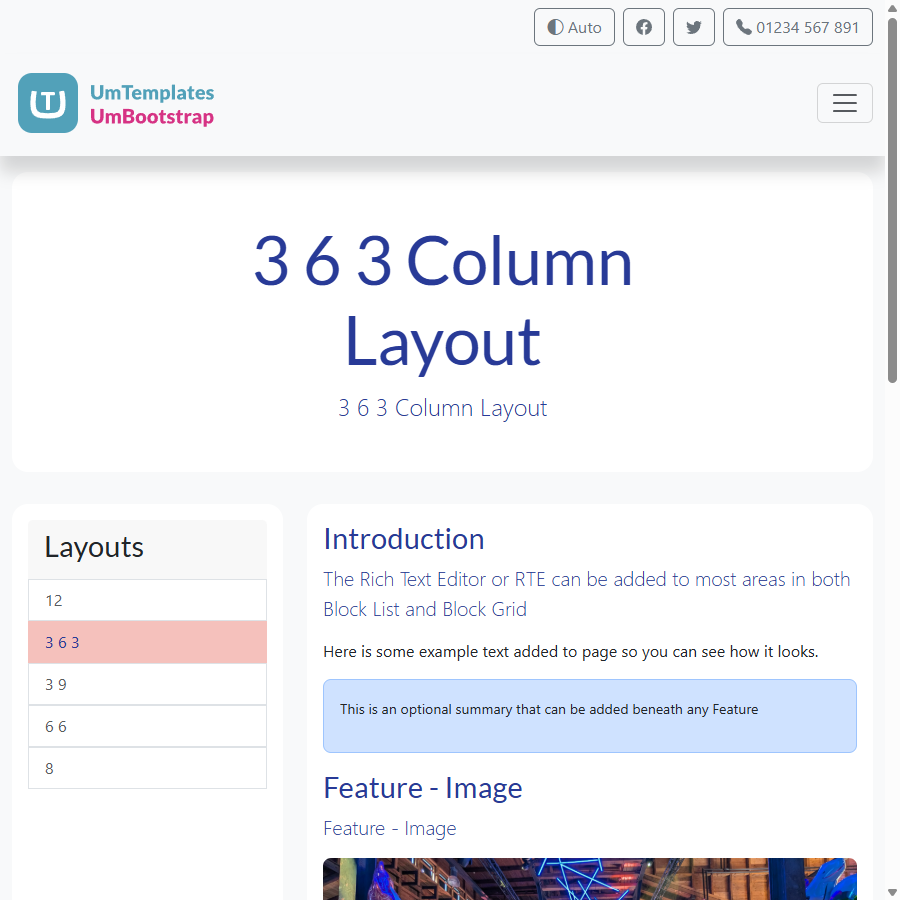

ResponsiveAreas gives Block Grid areas more than one layout.

This page shows how areas work today, where that falls short, and what we are building instead.

## How Block Grid areas work today

A Block Grid block can contain **areas**.
Areas are the slots editors put content into.

You set them up on the block type's **Areas** tab:

- **Grid Columns for Areas** sets how many columns the block has.
- Each area is a grey box with an alias.
- You drag a box's corner to set how many columns it spans.

This block has three areas: tertiary, primary and secondary.
They span 3, 6 and 3 of 12 columns.

On the front end, that gives a three-column layout.

## The problem

Each block has **one** layout.

3 | 6 | 3 works on a wide screen.
On a tablet or a phone, three columns are too narrow.
The areas need to change their spans, and sometimes their order.

Core has no way to say that.

### The workaround

The common workaround puts CSS framework classes into the area's **alias**.

The site's views print the alias as a class.
Bootstrap does the rest.

It works.
At tablet width, this block becomes 4 | 8, and the aside drops below.

But it has costs:

- **The alias becomes styling.** An alias should identify an area. Here it carries spans, padding and corner radius.
- **It is tied to one framework.** Change from Bootstrap and every alias breaks.
- **Editors cannot see it.** The Areas tab shows one layout. The tablet and phone layouts exist only as class names.
- **It is easy to break.** One typo in an alias changes the layout silently.

## How ResponsiveAreas works

ResponsiveAreas replaces the block type's **Areas** tab.
It keeps everything core does, and adds **layouts**.

- **Grid Columns for Areas** shows the real number, filled in from the data type.
- **The first layout** is core's own areas. It has no breakpoint, so it is used on every screen unless a layout below applies. Areas are added and edited here.
- **Each extra layout** has a **breakpoint alias**, such as `md`, and its own **grid columns**.
- **In every layout, the same areas** can be resized by the corner and reordered by dragging.

Aliases go back to being names.
See [Coming from classes in aliases](/explanation/coming-from-classes-in-aliases/) for how each part of an old alias moves.

## Watch it working

A three-minute tutorial: the front end, the Areas tab, the CSS it writes, and two live edits.

<video controls preload="metadata" width="100%" src="/video/responsive-areas-tutorial.mp4">
  <a href="/video/responsive-areas-tutorial.mp4">Download the ResponsiveAreas tutorial video (MP4, 23 MB)</a>
</video>

Transcript

1. Responsive Areas. Different area layouts for every screen size, in the Umbraco Block Grid.
2. Here is a block with four areas: A, B, C and D.
3. As the screen narrows, the areas change size and order. It's all set up in the backoffice. Let's see how.
4. Open the block in your Block Grid data type, and go to the Areas tab.
5. Grid Columns for Areas sets the grid. Here, twelve, filled in from the data type.
6. The first layout has no breakpoint. Add your areas here. It's used on every screen, unless a layout below applies.
7. Then add a layout for each breakpoint. Each one has a breakpoint alias, here large, medium and small, and its own grid columns. Every layout uses the same areas.
8. Drag a box to change its order. Drag its corner to change its size.
9. On the page, each area gets CSS variables. The breakpoint alias is on the end of each name. The values are the spans and order from the backoffice.
10. Your own CSS decides when each breakpoint applies. This site uses Bootstrap, so the medium layout uses Bootstrap's medium width.
11. The same variables work just as well with Tailwind, Foundation, or your own CSS. Only the breakpoint rule changes.
12. Let's change something. In the medium layout, area B is three columns wide. Drag its corner to six. Submit, and save.
13. One value changes. B's column span at medium goes from three to six.
14. Refresh at tablet width. B now spans the full width.
15. Now the small layout. Drag D to the front, and save.
16. The order values update. D is now first.
17. On a phone, D now comes first. Order changes what you see. The reading order stays the same as the first layout.
18. Responsive Areas. Set up in the backoffice, styled with your own CSS. Your areas are stored the standard Umbraco way, so your blocks keep working if you remove it.

## How the front end uses it

ResponsiveAreas does not decide when a layout applies.
**Your site's CSS does.**

ResponsiveAreas writes each area's span and order as CSS variables, one set per layout.
The breakpoint alias is on the end of each name, such as `--umb-block-grid--area-column-span--md`.
Your stylesheet decides which set to use at which screen size.

That means:

- **No CSS framework required.** Bootstrap, Tailwind, Foundation, your own grid, or nothing at all.
- **No breakpoint widths in the backoffice.** Editors and developers each work where they should.
- **Any grid model works.** Keep 12 columns and change spans, or change the column count itself.

The [front-end output reference](/reference/front-end-output/) has the details.

## What we are aiming for

- **Responsive areas that editors can see.**
- **Aliases that are just aliases.**
- **No dependency on any CSS framework.**
- **A tab that feels like part of Umbraco.**

ResponsiveAreas starts as a package.
The long-term aim is to propose it to Umbraco core.
